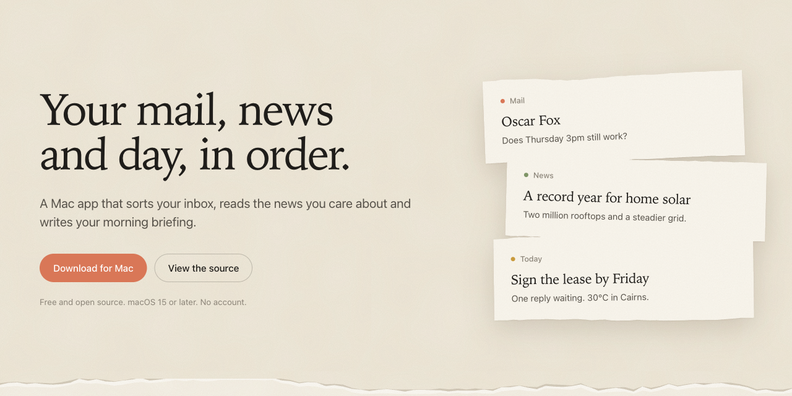
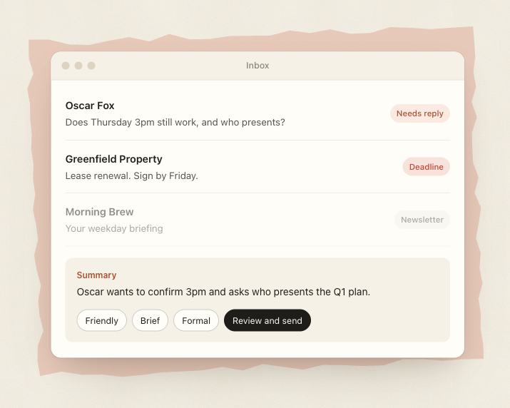
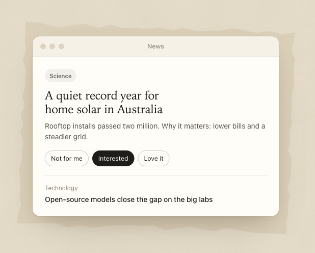
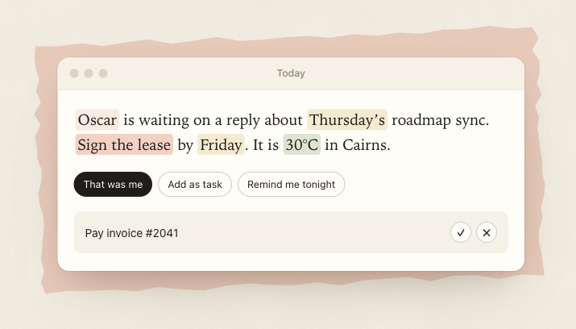

<p align="center">
  <a href="https://everyday.mandrusia.tech">
    <picture>
      <source media="(prefers-color-scheme: dark)" srcset="docs/images/banner-dark.png">
      
    </picture>
  </a>
</p>

<p align="center">
  <a href="https://github.com/Mandrusian/everyday/releases/latest"><b>Download for Mac</b></a>
  &nbsp;·&nbsp;
  <a href="https://everyday.mandrusia.tech">Website</a>
  &nbsp;·&nbsp;
  <a href="#build-it-yourself">Build it yourself</a>
  &nbsp;·&nbsp;
  <a href="https://everyday.mandrusia.tech/privacy.html">Privacy</a>
</p>

<p align="center">
  Free and open source. macOS 15 or later. No account, no servers, no tracking.
</p>

<br>

**everyday.** is a native Mac app that sorts your inbox, reads the news you care about and writes your morning briefing. It runs on your Mac and talks only to your mail server, your news sources, the weather service and, if you add a key, the AI provider you choose.

<br>

<table>
  <tr>
    <td width="50%" valign="middle">
      <h3>An inbox that sorts itself.</h3>
      Every message is read and labelled. The ones that need you rise to the top, each with a one-line summary. Replies are drafted in three tones, and nothing is sent, archived or deleted until you press the button.
    </td>
    <td width="50%">
      <picture>
        <source media="(prefers-color-scheme: dark)" srcset="docs/images/mail-dark.png">
        
      </picture>
    </td>
  </tr>
  <tr>
    <td width="50%">
      <picture>
        <source media="(prefers-color-scheme: dark)" srcset="docs/images/news-dark.png">
        
      </picture>
    </td>
    <td width="50%" valign="middle">
      <h3>News that learns what you like.</h3>
      Swipe through a few stories and it learns your taste. Duplicates are merged, every story links its source, and what it learns stays on your Mac. Add any RSS or Atom feed.
    </td>
  </tr>
  <tr>
    <td width="50%" valign="middle">
      <h3>A briefing, written each morning.</h3>
      What needs you, the weather and the stories that matter, in a short note you can have read aloud. Press “That was me” and it leaves the briefing. Deadlines in your mail become tasks you accept or dismiss.
    </td>
    <td width="50%">
      <picture>
        <source media="(prefers-color-scheme: dark)" srcset="docs/images/day-dark.png">
        
      </picture>
    </td>
  </tr>
</table>

## Features

- **Mail:** any IMAP account with an app password (Gmail, iCloud, Fastmail, Yahoo, custom), or the Gmail API with your own Google client. Automated mail from one sender is bundled. Snooze, VIP senders, a reviewed bulk-archive list, an unsubscribe helper that opens nothing until you approve, attachment Quick Look and a 10-second undo after sending.
- **Briefing:** streamed as it's written, with highlights for skimming. Choose what it includes, which topics to hide, and standing instructions in your own words.
- **News:** your sources, deduplicated and ranked by what you swipe, read and save. OPML import and export.
- **Tasks:** quick add understands “pay rent friday 5pm high” and repeats like “every friday”. Suggestions come from your mail.
- **Assistant:** ask about your day. Answers cite the mail and stories they used.
- **Voice:** natural speech through Gemini, cached on disk, or the best voice installed on your Mac.
- **Bring your own AI:** Gemini (free tier), Claude, OpenAI, a local model, or none. The inbox, news and tasks still work without AI.

## Privacy

There are no everyday. servers. Mail, tasks and everything the app learns live in a database on your Mac; keys and passwords live in the Keychain. Settings → AI provider → activity log shows every AI request and the exact text sent, and you can limit it to subject lines and snippets.

The AI only ever returns text. Sending, archiving and deleting live in one place in the code (`MailService`) and need a `UserApproval` that the interface creates only from a button you pressed.

## Install

1. Download the latest `.dmg` from [Releases](https://github.com/Mandrusian/everyday/releases/latest) and drag everyday. to Applications.
2. The app isn't signed with an Apple Developer ID yet, so the first time, right-click it and choose **Open**, or press **Open Anyway** in System Settings → Privacy & Security.
3. Follow the setup: add a mail account, pick your news, and optionally paste an AI key (a free Gemini key from [aistudio.google.com/apikey](https://aistudio.google.com/apikey) works).

## Build it yourself

You need the Xcode Command Line Tools (`xcode-select --install`); full Xcode isn't required.

```bash
git clone https://github.com/Mandrusian/everyday.git
cd everyday
./Scripts/bundle.sh          # builds build/everyday.app
open build/everyday.app
```

Run the self-checks (database, parsers, IMAP and SMTP against scripted servers, mail rules, news and weather):

```bash
swift run EverydayChecks
```

<details>
<summary><b>More for developers</b></summary>

<br>

**Live checks** use your own credentials and are opt-in:

```bash
GEMINI_API_KEY=... swift run EverydayChecks
IMAP_EMAIL=you@gmail.com IMAP_PASSWORD="app password" swift run EverydayChecks
GOOGLE_CLIENT_ID=... GOOGLE_CLIENT_SECRET=... swift run EverydayChecks
```

**A separate dev copy:** `./Scripts/dev.sh` runs with its own database, preferences and Keychain entries (`EVERYDAY_DEV=1`). `./Scripts/seed-dev.py` fills it with invented mail. `./Scripts/install.sh` updates `~/Applications/everyday.app`.

**Gmail API (optional):** create a Google Cloud OAuth client (Desktop app) with the Gmail API enabled and paste its ID and secret into Settings → Accounts. Scopes: `gmail.modify`, `gmail.compose`.

**Why no `@State`:** in the macOS 27 SDK `@State` is a macro whose plugin ships only with Xcode, so views use the `Local` wrapper in `Theme.swift`. XCTest also needs Xcode, hence the `EverydayChecks` executable.

**Screenshots:** `EVERYDAY_SNAPSHOT_DIR=/tmp/shots open --env EVERYDAY_SNAPSHOT_DIR=/tmp/shots build/everyday.app` writes a PNG per screen and quits.

**Releasing:** `./Scripts/release.sh 0.2.0` runs the checks, builds the app, makes a `.dmg` with a SHA-256 file and bumps `site/version.json` for the in-app update notice. With `DEVELOPER_ID` set it also signs and notarizes.

**Windows:** a port lives in `windows/` (a Rust core with its own tests and a Tauri app). GitHub Actions builds the installer. It hasn't been tested on a Windows machine yet; see [WINDOWS.md](WINDOWS.md).

**Website:** the static site is in `site/`; see [site/README.md](site/README.md).

</details>

## Known limits

- Unsigned for now, so macOS asks once on first open, and Keychain asks again after each update.
- Outlook and Hotmail no longer allow app passwords for IMAP.
- Mail refreshes every 15 minutes; there's no push yet.
- A sent reply waits 10 seconds so you can undo it; quitting during that time cancels it.
